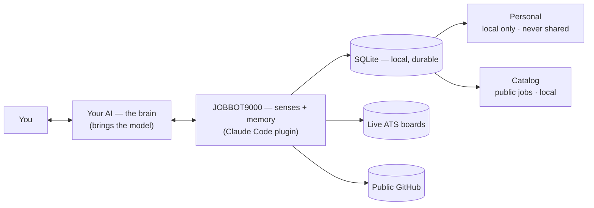
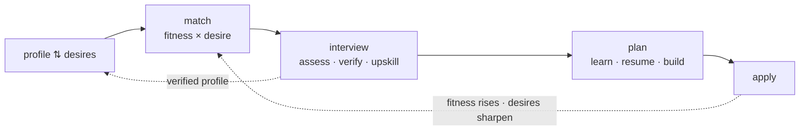

# jobbot9000

> **Offline foundation (local build):** discovery defaults to a local dry-run preview with zero fetches or catalog mutations. Network adapters have no live default; explicit execution requires injected adapters. No sending/submission capability exists. Use synthetic data only until private transcript retention and per-source terms have been reviewed.

A local, market-aware **job-search readiness loop** for your AI agent — packaged as a **Claude Code plugin**. One install bundles an MCP server (which reads the real job market and holds your journey) and the skills that drive it. Your agent is the brain; this is its senses and memory. Nothing is hosted, no keys leave your machine, and the whole journey persists locally across sessions that may span months.



## The loop — the product

jobbot is a **positive feedback loop** that takes a candidate from "looking" to "hired and better":



- **profile ⇅ desires** — what the user *can* do and what they *want* keep re-informing each other.
- **match** — roles scored on fitness **and** desire; the tension between them is the signal.
- **interview** — the engine. It **assesses** (the primary evidence for candidates with no public portfolio — depth is shown by explaining, not linking), **verifies** (separates a builder from a confident résumé), and **upskills** (shows what a great answer looks like). Repeatable as practice.
- **plan** — gaps become a tracked plan: things to **learn**, **resume** changes, and portfolio **projects to build**, grounded in real market demand.
- **apply** — a packet + a tailored cover letter, gated on honesty (write to the verified floor; never over-claim).
- **re-match** — closing gaps raises fitness and re-opens a higher band of roles. The loop turns.

## How it works

- **The agent is the brain; the server is senses + memory.** It reads the live market straight from company ATS boards and public GitHub, holds the journey in an embedded SQLite DB, and coaches honestly against real demand. It does not think — your agent does.
- **You bring the model; the server holds none** — no keys, tokens, or login. Single-tenant, local. That's why it's an MCP server, not a hosted app.
- **Durable & resumable.** State and the full history live in SQLite under the plugin's persistent data dir (survives sessions *and* plugin updates). An append-only **journal** records every meaningful step (assessments, interviews, plan changes, applications…), so a months-long search never loses progress and the whole timeline is reconstructable. **Every session starts with `orient`, which rehydrates state and surfaces open threads to resume.**

Two rules hold everywhere:

- **The agent never writes the database.** Only `src/db.ts` writes; tools call its accessors.
- **Judgment** (a competency level, a job's grade, a role fit, an upskilling plan, a cover letter) enters only through a named **structured-write tool** governed by a **grading mode** (a rubric + schema, in `modes/*.json`). The tool validates the agent's output and surfaces the mode's closed vocabularies as `z.enum`s.

**Honesty is architected in.** A resume/GitHub is treated as a *claim*, weighted by how *verified* it is (`corroborated` > `demonstrated` > `self_published` > `claimed`). Absence of a portfolio lowers **confidence**, never the level. `high` confidence requires an interview. Resume-building and upskilling raise *real* fitness — never fabricate experience.

**Two data planes:** **Personal** (profile, desires, resume, competency profile, interviews, plan, applications, journal) is **always local, never shared.** **Catalog** (companies + their live jobs — public market data) is local. Nothing leaves the machine.

## The surface — 16 tools

**Three doors:**

- **`orient(detail?)`** — start every session here. Where the user is in the loop, the next best action (`recommended_skill` — the router, priority-ordered over the loop's edges so every state has a way forward), **open threads to resume**, and the recent journal. `detail`: `recommend` (default), `dashboard` (the competency profile, market gap, plan, notes).
- **`look(at, …)`** — the one read door; never fetches, never writes. `at`: `jobs` (`market`/`relevant`/`worklist`), `companies`, `resume`, `portfolio`, `profile`, `competency`, `interview`, `plan`, `packet`, `applications`, `history`.
- **`gather(step, …)`** — the one fetch door. `step`: `find_companies` (discover → resolve ATS slugs; free by default, TheirStack opt-in), `fetch_jobs` (pull live ATS boards), `ingest_portfolio` (public GitHub repos + verification signals).

**Twelve writes** — five mechanical, seven judgment (each governed by a mode):

| Tool | Plane | Mode |
|---|---|---|
| `capture_profile` | personal | — (identity + **desires**) |
| `set_resume` | personal | `resume_revision` when a rationale is given (a coached revision, journaled); else a wholesale user edit |
| `add_portfolio_project` | personal | — (a described/private project; added **unverified**) |
| `record_application` | personal | — (reported status) |
| `update_plan_progress` | personal | — (suggested → in_progress → done) |
| `assess_competency` | personal | `competency_profile` (per-dimension; skeptical; absence ≠ low level) |
| `record_interview` | personal | `interview` (competency or role-fit) |
| `grade_job` | catalog | `job_intrinsic` |
| `assess_role_fit` | personal | `role_fit` (per-dimension + desire alignment) |
| `grade_portfolio_project` | personal | `portfolio_relevance` |
| `recommend_upskilling` | personal | `upskilling_plan` (learn/resume/build, market-grounded) |
| `record_cover_letter` | personal | `cover_letter` (gated on verified confidence) |

**Application tracking is durable and substantive.** The user alone submits applications; `record_application` records their reported status and metadata. Omit `applied_at`, `next_action`, `next_action_at`, or `notes` to retain the saved value; pass `null` to explicitly clear it. Empty strings remain explicit text, without trimming or normalization. For a completed follow-up, keep the current status and pass both `next_action: null` and `next_action_at: null`.

Creating an application or changing its status appends an `applied` journal event. Keeping the same status while changing metadata appends `application_updated`, with the changed fields and their `from`/`to` values in the local event summary. An exact repeat appends no event and does not touch the row. The tool returns `changed`, `transitioned`, and `changed_fields`. `updated_at` remains the time of the last status transition, so editing a rejected application's notes does not re-trigger rejection feedback. Read the current pipeline through `look({ at: 'applications' })` and the journal through `look({ at: 'history' })`; both are read-only. Start with `orient` to resume open application next actions.

The competency profile is **multi-dimensional** — `technical_depth`, `system_design`, `communication`, `ownership` — each with a level, confidence, and provenance-tagged evidence; the overall band is derived.

**Interviews resume by context.** Role-fit interviews require an existing `job_id`; `look({ at: 'interview', job_id })` or an explicit `interview_id` selects the read context. In `record_interview`, an explicit `interview_id` resumes only an `in_progress` session matching the supplied type and job context. Without it, the tool resumes the unique matching open session or starts one when none match; ambiguity returns `candidate_interview_ids` for an explicit choice. `done: true` requires a nonblank summary. Preconditions are checked before writes, and session start, items, completion, and their journal events persist atomically. Appends have no retry idempotency token: if a success response is lost, inspect the saved session before retrying rather than blindly replaying items.

## The skills

Five playbooks, invoked automatically by their `description` (and as `/jobbot9000:<name>`): **coach** (onboard + assess), **verify** (the competency interview), **upskill** (plan + resume + projects), **job-search** (discover + grade + match), **application** (rehearse + apply + track). Each opens with `orient`, so any session resumes the loop.

Company discovery and live job fetching are **keyless and free by default**; TheirStack is an **opt-in paid accelerator** (`THEIRSTACK_API_KEY`, count-first, credit-ceiling-gated). Greenhouse / Ashby / Lever are verified against live boards; Workable is best-effort.

## Install (Claude Code)

Claude Code installs plugins from a **marketplace**. Two ways:

**Quick / development — `--plugin-dir`** (session-scoped):

```
claude --plugin-dir /path/to/jobbot9000
```

**Persistent — via the bundled local marketplace:**

```
/plugin marketplace add /path/to/jobbot9000
/plugin install jobbot9000@jobbot9000
```

Verify with `/mcp` — you should see `plugin:jobbot9000:jobbot · connected · 16 tools`.

**Requires Node 22.13+** (24 LTS or newer recommended) — that's where Node's built-in SQLite (`node:sqlite`) is available unflagged.

On the first session after install, a bootstrap hook (`hooks/hooks.json` → `scripts/bootstrap.mjs`) installs the server's dependencies into the persistent data dir and builds it; it no-ops afterward. Setup is fast: every dependency is pure JavaScript, so there's nothing to compile and no build toolchain needed.

**Upgrading Node needs no action.** The server has no native dependency — SQLite comes from the Node runtime itself (`src/sqlite.ts`), so nothing is tied to Node's ABI. A native SQLite driver would have to be recompiled (and wait on upstream prebuilds) for every new Node major; this one just keeps working. Your database is a plain SQLite file, unchanged by the switch.

State and the local catalog live in an embedded SQLite database under `${CLAUDE_PLUGIN_DATA}/.private/state/` (resolves to `~/.claude/plugins/data/<plugin-id>/state/`), which survives across sessions **and** plugin updates. (Fallback: `~/.jobbot/.private/state`.) Uninstalling deletes the data dir unless you pass `--keep-data`.

## Develop

```
npm install
npm run build      # compile the MCP server to dist/
npm run dev        # run the server over stdio (tsx)
npm test           # offline test suite (tsx against src/, mocked HTTP — no network/key)
                   #   test/sqlite.test.mjs    — the node:sqlite driver seam
                   #   test/discovery.test.mjs — ATS/providers/gather + the loop
```

The server reads `STATE_DIR` (the plugin sets it to `${CLAUDE_PLUGIN_DATA}/.private/state`) and opens `jobbot.db` there; unset, it falls back to `~/.jobbot/.private/state`.

**Heads-up when running Claude Code *inside* this repo:** the root `.mcp.json` is auto-discovered as a *project* server but `${CLAUDE_PLUGIN_ROOT}` only expands in *plugin* context, so that project-scoped copy fails harmlessly (`MCP error -32000`). Run `claude --plugin-dir` from **outside** the repo, or disable the project `jobbot` server in `/mcp`. The real plugin shows as `plugin:jobbot9000:jobbot`.

**Discovery env (all optional — discovery is free without any of it):** `find_companies` defaults to the free curated roster + on-demand path; ATS resolution is keyless. `JOBBOT_SEEDS_FILE` points the roster at your own file. Only the opt-in TheirStack accelerator reads `THEIRSTACK_API_KEY` + `THEIRSTACK_MAX_CREDITS_PER_RUN` (default `150`). `ingest_portfolio` reads public GitHub keylessly; `GITHUB_TOKEN`, if set, only raises the rate limit (and makes authorship verification more reliable).

## Layout

```
.claude-plugin/plugin.json   plugin manifest
.mcp.json                    bundled MCP server config
src/
  index.ts                   stdio entry; registers the tools
  db.ts                      SQLite schema + accessors — the only code that writes the DB (incl. the journal + history)
  sqlite.ts                  the SQLite driver — node:sqlite (built into Node), so there is no native dep to rebuild
  state.ts                   the loop state machine (state derived from what data exists)
  tools.ts                   the 16-tool surface
  providers.ts               lead-gen seam — curated (free, default) + TheirStack (opt-in)
  ats.ts                     keyless ATS — slug resolution + board fetch/normalize (Ashby/Greenhouse/Lever/Workable)
  github.ts                  keyless GitHub sense — public repos + verification signals (authorship/traction/badges)
seeds/                       curated company roster (free default for find_companies); ships empty
skills/                      bundled skills: coach / verify / upskill / job-search / application
modes/                       grading modes (rubric + schema) for the judgment writes
hooks/, scripts/             SessionStart bootstrap (install + build on first run)
```

## Extending

Any extension must respect the invariants — **the agent never writes the DB** (only `db.ts`), **judgment enters only through a mode-governed named write**, **tools are safe in any call order** (degrade with an honest note, never throw), and **no union input schemas**.

- **A new read view** → add an `at` case to **`look`**.
- **A new judgment** → register a named structured-write tool + a grading mode (`modes/<name>.json` with `rubric`, `output_schema`, and `constraints` carrying the closed `*_must_be_one_of` vocabularies); the tool builds its `z.enum`s from the mode.
- **A new external fetch** → add a `step` case to **`gather`**, persist via a `db.ts` helper, return the findings.
- **A new skill** → drop `skills/<name>/SKILL.md` with `name` + `description` frontmatter; it auto-registers as `/<name>`.
- **A new journey dimension** → extend the `Dimension` union in `src/state.ts` and add its predicate in `readJourneyState`.
- **Durability** → any new stateful step persists in the DB and, if it's a meaningful event, appends to the `events` journal (`db.logEvent`), so a fresh session resumes it.

## Private storage boundary

Personal state, discovery run state, SQLite sidecars, drafts and receipts belong only under a git-ignored `.private/` directory. The plugin selects `${CLAUDE_PLUGIN_DATA}/.private/state`; standalone use defaults to `~/.jobbot/.private/state`. An absolute `STATE_DIR` may select a directory under `.private`, with optional `JOBBOT_PRIVATE_DIR` naming that exact `.private` anchor. Relative/unexpanded paths, escapes, symlink components, and multiply linked database files are rejected. Private directories are tightened to 0700 and database files to 0600. This guards accidental path escape; it is not isolation from another process running as the same user.

Existing legacy state is never opened, moved or deleted automatically. Back up legacy data and obtain an explicit migration decision before using a new private location; this change opens a new schema-compatible private database. Operator application/interview contracts have offline synthetic regression coverage. Harness transcripts can retain tool outputs outside the private root; real personal use remains on hold until the operator resolves retention. Do not treat SQLite containment alone as satisfying transcript privacy.

Run offline tests with `npm test` (Node's `--import tsx` loader avoids the tsx CLI IPC socket). No test needs live endpoints, real profiles or credentials.

## Offline discovery loop

The bounded company-discovery library supports synthetic paged leads, manual targets, official-shaped ATS fixtures, source-policy checks, shared in-process limits, private checkpoints, cancellation and explicit stale refresh. It has no installed transport or MCP/CLI loop surface. See [the discovery contract and verification matrix](docs/DISCOVERY.md) for interfaces, test coverage and live-use limitations.

## Offline people discovery

Stage (b) collects explicitly published recruiter/hiring-manager evidence into a private review queue using injected synthetic publications. It enforces source/LinkedIn restrictions, published professional channels, 30-day default evidence expiry, and suppression/deletion. No contacting, invitations, mailbox probes or outreach drafts are available. See [the people discovery contract](docs/PEOPLE.md) for the acceptance matrix, private-storage boundary and retention limitations. Real people and live discovery remain on hold.

## Offline draft preparation and review

Stage (c) compiles verified-floor drafts and immutable private review revisions. `jobbot review <batch-rN>` (or MCP `review_batch`) shows every draft, destination, field and attachment without truncation. `jobbot approve-send <batch-rN> --sha256 <digest>` fails closed: this runtime cannot distinguish an operator-only identity from workers. Stage (c) exposes no transport or executor. See [preparation, commands and the approval boundary](docs/PREPARATION.md) for the explicit later private-only resume import command and synthetic verification scope.

## Mock execution with Odin-issued approvals

Stage (d) verifies canonical Ed25519 artifacts from Odin's authenticated operator path and records single-use consumption, intents and receipts privately. Only a mock adapter exists; the executor is not a worker CLI/MCP tool. Run `npm run demo:stage-d -- --send` for the synthetic demonstration, or omit `--send` for zero mock calls. See [Option A, protected verification keys and recovery](docs/EXECUTION.md). Real channels and production key provisioning remain separate operator decisions.
